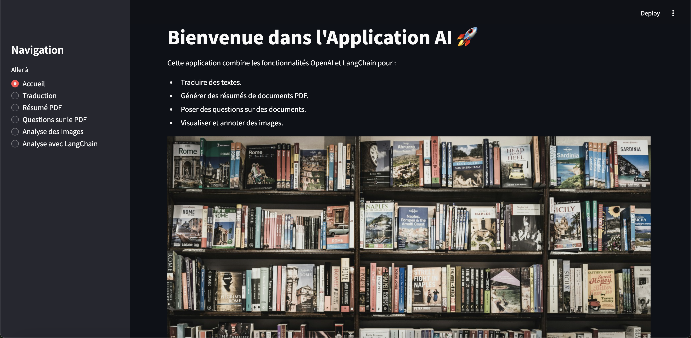

# LLM-LangChain-and-OpenAI
LLM, Outils puissants pour extraire des insights à partir de textes et d'images avec LangChain et OpenAI.


# Application AI : Traduction, Résumé et Analyse de Données 

Cette application interactive, construite avec **Streamlit**, exploite la puissance de l'API OpenAI, **LangChain**, et des outils d'analyse d'image pour fournir des fonctionnalités avancées de traitement de texte et d'image.

## Aperçu de l'Application




## Fonctionnalités Principales 

### 1. **Analyse de Documents PDF** 
- **Extraction de texte** : Chargez un fichier PDF et extrayez son contenu en texte brut.
- **Résumé automatique** : Générez un résumé condensé et pertinent à partir du contenu d'un PDF.
- **Traduction multilingue** : Traduisez du texte extrait ou saisi dans plusieurs langues (anglais, français, espagnol, allemand, etc.).
- **Questions sur le contenu** : Posez des questions sur le contenu du PDF et recevez des réponses précises grâce à LangChain.

### 2. **Analyse d'Images** 
- **Annotation d'images** : Chargez une image et obtenez une description contextuelle en utilisant l'API OpenAI.
- **Analyse des couleurs dominantes** : Identifiez les couleurs principales d'une image à l'aide de l'algorithme K-Means.
- **OCR (Reconnaissance Optique de Caractères)** : Extrait du texte des images avec PyTesseract pour une utilisation ultérieure.

### 3. **LangChain pour l'Analyse Avancée**
- Intégration avec LangChain pour diviser et analyser des documents volumineux.
- Réponses interactives basées sur le contenu d'un document.

## Technologies Utilisées 

### Langages et Frameworks
- **Python** : Langage principal pour la manipulation de données et l'intégration des API.
- **Streamlit** : Interface utilisateur interactive et intuitive.
- **LangChain** : Outils de traitement avancé pour la manipulation de documents.

### Bibliothèques et Outils
- **OpenAI API** : Traduction, résumé et génération de réponses.
- **PyPDF2** : Extraction de texte à partir de fichiers PDF.
- **PyTesseract** : OCR pour l'extraction de texte depuis des images.
- **K-Means** : Clustering des couleurs dominantes dans les images.
- **Matplotlib** : Visualisation des résultats analytiques.

## Installation et Configuration 

### Prérequis
- **Python 3.8 ou supérieur**
- Une clé API OpenAI enregistrée dans un fichier `.env`.

### Étapes d'installation
1. Clonez ce dépôt :
   ```bash
   git clone https://github.com/votre_nom_utilisateur/nom_du_projet.git
   cd nom_du_projet
   ```
2. Installez les dépendances :
   ```bash
   pip install -r requirements.txt
   ```
3. Configurez votre clé API OpenAI dans un fichier `.env` :
   ```env
   OPENAI_API_KEY=your_openai_api_key
   ```
4. Lancez l'application :
   ```bash
   streamlit run nom_du_fichier.py
   ```

## Utilisation 

1. **Navigation via la barre latérale** : Choisissez parmi les options disponibles (Accueil, Traduction, Résumé PDF, Questions sur le PDF, Analyse d'Images).
2. **Chargement de fichiers** : Chargez un fichier PDF ou une image et exploitez les fonctionnalités interactives.
3. **Résultats en temps réel** : Obtenez des traductions, résumés, analyses de couleurs ou réponses instantanées.

## Points de Vigilance 

- **Limites des APIs** : Assurez-vous de surveiller l'utilisation de votre clé OpenAI pour éviter des coûts inattendus.
- **Précision de l'OCR** : Les résultats peuvent varier selon la qualité des images fournies.
- **LangChain** : Pour les documents volumineux, divisez les fichiers pour une meilleure performance.

## Améliorations Futures 
- Intégration avec d'autres modèles d'IA pour une analyse plus approfondie.
- Optimisation des pipelines de traitement pour les grands fichiers PDF et images.
- Ajout d'options de personnalisation des résultats (formats de résumé, styles de traduction, etc.).

---

### Auteur 
Créé par [Khoty WOLIE](https://github.com/Khoty-WOLIE).

N'hésitez pas à me contacter pour toute question ou suggestion !
